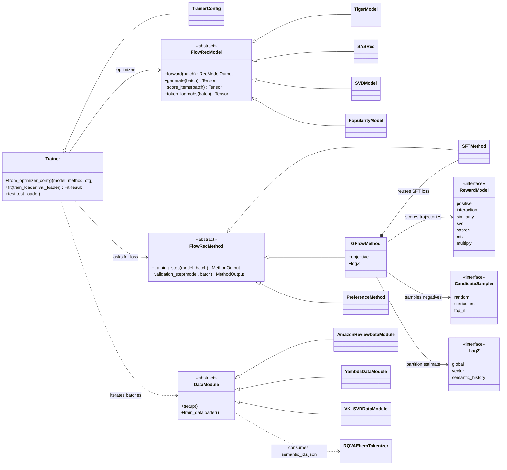

# FlowRec

FlowRec is a modular research framework for fine-tuning **generative recommendation** models with
supervised, flow-based, RL-based, and preference-optimization objectives. It builds discrete
**semantic item IDs** from content embeddings with an RQ-VAE, trains a
[TIGER](https://arxiv.org/abs/2305.05065)-style encoder–decoder to generate the next item's semantic
ID, and then fine-tunes it with a GFlowNet trajectory-balance objective so the sampling distribution
matches a reward signal.

## Main goals

- Train and fine-tune generative recommendation models such as **TIGER** (T5 encoder–decoder over semantic-ID tokens).
- Build semantic item IDs from item descriptions using content embeddings and **RQ-VAE**.
- Support standard **SFT** training as well as **GFlowNet** (trajectory-balance) fine-tuning, with hooks for DPO/GRPO/RL.
- Use **SASRec**- and **SVD**-style models as baselines, candidate generators, or collaborative reward models.
- Provide reproducible experiments through **config-driven pipelines** (a single JSON per experiment).

## Table of contents

- [Installation](#installation)
- [Repository structure](#repository-structure)
- [Architecture](#architecture)
- [Quick start](#quick-start-smoke-test)
- [End-to-end example: build IDs and train a model](#end-to-end-example-build-ids-and-train-a-model)
- [Configuration reference (hyperparameters)](#configuration-reference-hyperparameters)
  - [`data` / `dataset`](#data--dataset)
  - [`dataloader`](#dataloader)
  - [`model` — TIGER](#model--tiger)
  - [`model` — SASRec](#model--sasrec)
  - [`method` — SFT](#method--sft)
  - [`method` — GFlowNet](#method--gflownet)
  - [`training` (trainer)](#training-trainer)
  - [`optimizer`](#optimizer)
  - [RQ-VAE / semantic-ID builder](#rq-vae--semantic-id-builder)
- [Reward models and candidate samplers](#reward-models-and-candidate-samplers)
- [Experiment pipelines](#experiment-pipelines)
- [Datasets](#datasets)
- [Metrics and outputs](#metrics-and-outputs)

## Installation

FlowRec requires **Python ≥ 3.10** (it relies on `@dataclass(slots=True)`). There is no packaging
file yet — clone the repo and install the pinned dependencies into a virtual environment:

```bash
git clone https://github.com/Anaxagor/flowrec.git
cd flowrec
python -m venv .venv && source .venv/bin/activate
pip install -r requirements.txt
```

[`requirements.txt`](requirements.txt) pins the versions verified in the working environment
(some pins are deliberately old so the same file installs on glibc-2.17 cluster login nodes —
see the comments inline). Optional extras are listed, commented out, at the bottom of the file:
`comet-ml` (experiment logging), `datasets` (raw-data download tooling), `murmurhash` (faster
user-id hashing), `scikit-learn` (exp5 gate-controller training), and `jupyter` (the notebooks
in `examples/`).

Scripts add the repo root to `sys.path` themselves, so you can run them directly (`python scripts/...`)
without installing the package. Verify the setup with the synthetic smoke test below.

## Repository structure

```text
flowrec/
├── configs/                 # One JSON per experiment (TIGER SFT, GFlowNet variants, SASRec)
│   └── exp2-tuned-params/           # Tuned dataset/model configs + fine-tune protocol
│                                    # (finetune_gflow.json / finetune_sft_only.json control)
├── scripts/                 # CLI entry points (build embeddings/IDs, run_tiger, run_sasrec, ...)
│   ├── exp1-standard-params/        # SASRec baselines on every dataset (3 seeds)
│   ├── exp2-tuned-params/           # Tuned-hyperparameter TIGER / SASRec runs
│   ├── exp4-reward-ablations/       # GFlow fine-tuning reward-ablation grids
│   ├── exp5-budgeted-cyclic/        # Pilot budgeted-cyclic driver (monolithic)
│   └── exp5_budgeted_cyclic/        # Staged cluster pipeline (stages 00–09 + Slurm), see its README
├── examples/                # Notebooks: baselines, semantic-ID construction, filter-stat reports
├── flowrec/
│   ├── data/                # DataModules, datasets, preprocessors, splits, collators
│   │   ├── datamodule.py            # AmazonReviewDataModule / AmazonReviewDataConfig
│   │   ├── yambda.py                # YambdaDataModule / YambdaDataConfig
│   │   ├── vk_lsvd.py               # VKLSVDDataModule / VKLSVDDataConfig
│   │   ├── sequence_builder.py      # split strategies + train-target policies
│   │   ├── collators.py             # SequenceBatchCollator (item- and token-level tensors)
│   │   └── post_split_filtering.py  # cold-item filtering after the split
│   ├── item_representation/ # Content embeddings + semantic IDs
│   │   ├── content_embeddings.py    # HF / hashing text embedders, Amazon text builder
│   │   └── semantic_id/             # RQ-VAE, tokenizer, codebook, collision resolution
│   ├── models/              # tiger.py, sasrec.py, svd.py, popularity.py, base.py
│   ├── ft_methods/          # Fine-tuning objectives
│   │   ├── sft/                     # Supervised fine-tuning (token/item cross-entropy)
│   │   ├── gflow/                   # GFlowNet: method, config, flow (logZ), losses/
│   │   └── preference/              # DPO/preference scaffold
│   ├── rewards/             # interaction (positive + logged-evidence), similarity, svd, sasrec, mix
│   ├── candidates/          # SemanticIDCandidateSampler (random / curriculum / top_n modes)
│   ├── trajectories/        # Semantic-ID trajectory machinery
│   │   ├── budgeted.py              # Exact finite-budget DPs + samplers (exp5 cyclic rollbacks)
│   │   └── nonacyclic.py            # Non-acyclic (rollback) trajectory experiment support
│   ├── training/            # Generic Trainer + TrainerConfig + experiment loggers
│   ├── evaluation/          # ranking.py: shared Recall/NDCG/MRR/coverage from target ranks
│   └── inference/           # Generation helpers
└── tests/                   # Unit and smoke tests
```

## Architecture

FlowRec cleanly separates **models** (what maps a history to predictions), **methods** (what loss to
optimize), and the **trainer** (the method-agnostic optimization loop). A `DataModule` turns raw
interactions into batches; for GFlowNet, a **reward model** and a **candidate sampler** turn each batch
into scored trajectories.



**Flow of a GFlowNet training step**

```
batch (history + target) ─▶ CandidateSampler ─▶ positive + N negative semantic-ID trajectories
                                   │
                                   ▼
                            RewardModel ─▶ rewards R[B, N]
                                   │
                                   ▼
       GFlowMethod: SFT loss on the positive  +  trajectory-balance loss
                    ( logZ + Σ_t log P_θ(token_t | history) − log R )²
                                   │
                                   ▼
                       Trainer.step() ─▶ updates TIGER (+ logZ)
```

## Quick start (smoke test)

The fastest way to confirm everything works is the synthetic smoke test — it builds a tiny dataset,
trains TIGER with SFT and GFlowNet for a few steps on CPU, and exits:

```bash
python scripts/smoke_test.py --device cpu
```

## End-to-end example: build IDs and train a model

The full pipeline goes **content embeddings → semantic IDs → SASRec teacher → TIGER (SFT) → TIGER
(GFlowNet)**. Every training step is driven by a JSON config in [`configs/`](configs/); the CLI flags
below only override the config path, device, seed, and step/epoch caps.

### Step 0 — Prepare the data (Amazon example)

FlowRec's data pipeline is **DataFrame-first**. Point `data.reviews_path` at a **Parquet** file of
interactions and (optionally) `data.metadata_path` at a **Parquet** file of item records. In both
files **each row is a single record**: one row per user↔item interaction in the reviews file, and one
row per item in the metadata file. See [Input data format](#input-data-format) below for the exact
columns each file must contain.

Parquet is the primary, fast path. Strict **JSONL**/**JSON** (optionally `.gz`) are still accepted as
compatibility inputs and are normalized through the same DataFrame code, so existing TIGER-style
exports keep working. To convert an existing TIGER-style `inter.json` into an interactions file:

```bash
python scripts/convert_tiger_interactions.py \
  --reviews-path data/raw/reviews_Beauty.json.gz
# → data/processed/tiger_beauty_interactions.jsonl
```

#### Input data format

**Reviews / interactions file** (`data.reviews_path`) — one row per interaction. `dataset.item_key`
selects which column identifies the item (`asin` in the reference Beauty Parquet).

| Column | Required | Type | What it holds |
| --- | --- | --- | --- |
| `user_id` | ✅ | string | Identifier of the user in the interaction. |
| `asin` | ✅ | string | Identifier of the interacted item (the `dataset.item_key` column). |
| `timestamp` | ✅ | int | Interaction time (Unix seconds); used to order each user's history. |
| `rating` | optional | float | Explicit feedback (1–5); default reward signal. Missing → `0.0`. |
| `verified_purchase` | optional | bool | Verified-purchase flag; enables `use_verified_only` and the `amazon_log` reward. |

Accepted column aliases (for JSONL/JSON Amazon dumps): `reviewerID`/`reviewer_id` → `user_id`,
`parent_asin`/`asin` → item key, `unixReviewTime`/`sort_timestamp` → `timestamp`, `overall` →
`rating`, `verified` → `verified_purchase`.

**Metadata file** (`data.metadata_path`, optional) — one row per item, used to build content
embeddings and semantic IDs. Items are keyed by `parent_asin` and joined to the item id in the
interactions file.

| Column | Required | Type | What it holds |
| --- | --- | --- | --- |
| `parent_asin` | ✅ | string | Item identifier; joined to the interactions' item key. |
| `title` | optional | string | Item title (primary embedding text). |
| `description` | optional | string / list | Long-form description. |
| `categories` | optional | list / string | Category path(s). |
| `main_category` | optional | string | Top-level category. |
| `price` | optional | float / string | Item price. |

Additional text-bearing columns are used when present (`store`, `brand`, `features`, `details`), and
any extra columns are preserved on the DataFrame. Only rows whose item id also appears in the
interactions are kept.

### Step 1 — Build content embeddings

Encode each item's text (title, categories, description, …) into a dense vector with a
sentence-transformer (or the dependency-free `hashing` embedder for tests):

```bash
python scripts/build_item_embeddings.py \
  --source metadata \
  --metadata-path data/raw/meta_Beauty.jsonl.gz \
  --item-key asin \
  --embedder hf \
  --model-name sentence-transformers/all-MiniLM-L6-v2 \
  --device cuda \
  --batch-size 128 \
  --output-path artifacts/item_embeddings/beauty.pt
```

### Step 2 — Train the RQ-VAE and export semantic IDs

Quantize the embeddings into discrete, hierarchical semantic IDs. This writes `semantic_ids.json`
(the `{item_id: [token, token, ...]}` map every generative config points at):

```bash
python scripts/build_rqvae_semantic_ids.py \
  --embeddings-path artifacts/item_embeddings/beauty.pt \
  --output-dir artifacts/tokenizers/rqvae_beauty \
  --num-codebooks 4 --codebook-size 256 \
  --latent-dim 32 --hidden-dims input,128,64 \
  --epochs 20 --batch-size 512 --learning-rate 3e-4 \
  --normalize l2 --collision-policy random_append --level-offset-tokens true
```

### Step 3 — Train a SASRec baseline (optional teacher / reward model)

SASRec is a strong baseline on its own, and its checkpoint can later serve as a **reward model** or
**candidate sampler** for GFlowNet:

```bash
# Every exp1 dataset sequentially: Beauty, Instruments, Beauty 2023,
# Yambda 50M, and Yambda 500M (three seeds each).
python scripts/exp1-standard-params/run_sasrec_all.py --device cuda:0

# Or any subset:
python scripts/exp1-standard-params/run_sasrec_all.py \
  --datasets beauty instruments \
  --device cuda:0
```

The exp1 configuration trains SASRec identically on every dataset —
dense-causal windows with left padding and full-catalog cross-entropy — for
seeds 42, 43, and 44; the runner refuses configs that resolve to any other
training layout.
Best checkpoints are written under `checkpoints/exp1-standard_params/sasrec/`:
`<dataset>/seed_<seed>/best.pt` for Beauty and Instruments,
`amazon-2023/beauty_2023/seed_<seed>/best.pt` for Beauty 2023, and
`yambda/<dataset>/seed_<seed>/best.pt` for Yambda. Validation and test HR,
NDCG, Coverage, and ARP at 5, 10, and 20 for every completed run are combined
in `artifacts/exp1-standard_params/sasrec_all_metrics_summary.csv` (rewritten
after each run so interrupted sweeps keep their finished results). Per-dataset
tables are written next to it: `sasrec_beauty_metrics_summary.csv`,
`sasrec_instruments_metrics_summary.csv`,
`sasrec_amazon_2023_metrics_summary.csv`,
`sasrec_yambda_50m_listens_metrics_summary.csv`, and
`sasrec_yambda_500m_listens_metrics_summary.csv`.

On the cluster, `scripts/slurm/run_sasrec_all_array.sbatch` trains all five
datasets as a Slurm array with one dataset per task. Single-dataset runs skip
the shared `sasrec_all_metrics_summary.csv` and write only their per-dataset
table, so concurrent array tasks never overwrite each other's results.

The Yambda runner is offline-only and expects the predownloaded interaction
files at `data/raw/yambda/flat/50m/multi_event.parquet` and
`data/raw/yambda/flat/500m/multi_event.parquet`, plus item embeddings at
`data/raw/yambda/embeddings.parquet`. These paths can be changed in
`configs/exp1-standard_params/dataset_yambda.yaml`.

### Step 4 — Train TIGER with supervised fine-tuning (SFT)

This is the core "train the generative model" step. It reads the interactions and `semantic_ids.json`,
builds the T5 model, and trains it to generate the next item's semantic ID:

```bash
python scripts/run_tiger.py --config configs/tiger_beauty.json --device cuda:0
# handy overrides:
python scripts/run_tiger.py --config configs/tiger_beauty.json \
  --run-name tiger_beauty_sft --seed 42 --max-steps 200000
```

Each run creates an immutable folder under `experiments/tiger/<timestamp>_<name>_<hash>/` containing
`resolved_config.json`, `training_log.jsonl`, `checkpoints/` (`best.pt`, `last.pt`), and
`final_summary.{json,md}`.

### Step 5 — Fine-tune TIGER with GFlowNet (trajectory balance)

Start from the SFT checkpoint (`training.init_checkpoint_path`) and fine-tune so the model's sampling
distribution is proportional to a cached full-catalogue reward. Build the cache first, then run the
canonical curriculum-sampling example:

```bash
python scripts/precompute_reward_cache.py --config <reward-config.json> --output-dir <cache-dir>
python scripts/run_tiger.py \
  --config configs/tiger_beauty_gflow_mix_curriculum_example.json --device cuda:0
```

`precompute_reward_cache.py --per-user-last-n N` caches only each user's last *N* training
examples — a deterministic fine-tuning subset that leaves the datamodule and its item catalog
untouched, so checkpoints trained on the full layout still load. Training must then use the
same per-user tail subset.

## Configuration reference (hyperparameters)

An experiment config is a single JSON with top-level sections: `data`, `dataset`, `dataloader`,
`model`, `method`, `training`, `optimizer`, and (optional) `comet`. The tables below list the keys
you set inside each section, the default the loader falls back to, and what the key controls.

### `data` / `dataset`

Paths live under `data`; everything about filtering, splitting, and sequence construction lives under
`dataset`.

| Key (section) | Default | What it controls |
| --- | --- | --- |
| `data.reviews_path` | — (required for Amazon) | Interactions file, one row per user↔item interaction (Parquet preferred; JSONL/JSON(.gz) accepted). See [Input data format](#input-data-format). |
| `data.metadata_path` | `null` | Optional item metadata file, one row per item (Parquet preferred), used when building embeddings. See [Input data format](#input-data-format). |
| `data.semantic_id_path` | `null` | `semantic_ids.json` map; **required for TIGER**. |
| `data.source` | `amazon` | Dataset backend: `amazon` or `yambda`. |
| `dataset.item_key` | `parent_asin` | Which column identifies an item in the **interactions** file (`asin` for the reference Beauty data). Item records in the metadata file are keyed by `parent_asin`. |
| `dataset.positive_criterion` | `null` | Pandas query expression that defines a *positive* interaction (e.g. `"rating >= 4"`); splits the log into the positive stream (targets) and the auxiliary stream consumed by the `interaction` reward. `null` treats every interaction as positive. |
| `dataset.num_codebooks` | = semantic-ID length | Number of RQ-VAE levels; validated against the loaded IDs. |
| `dataset.max_sequence_length` | `20` | Reference length; `max_history_len` defaults to this − 1. |
| `dataset.min_user_interactions` | `5` | Drop users with fewer interactions (k-core). |
| `dataset.min_item_interactions` | `0` | Drop items with fewer interactions (k-core). |
| `dataset.split_strategy` | `leave_one_out` | `leave_one_out` (per-user last-2) or `global_time` (chronological cutoffs). |
| `dataset.min_history_len` | `1` | Minimum history length for a valid training example. |
| `dataset.train_target_policy` | `all` | Which positions become train targets: `all`, `last`, `last_n`, `stride`, `sampled`, `hybrid`. |
| `dataset.train_all_prefixes` | `true` | Legacy switch; prefer `train_target_policy`. |
| `dataset.train_last_n` | `512` | Number of most-recent targets when policy = `last_n`. |
| `dataset.train_stride` | `10` | Step size when policy = `stride`. |
| `dataset.train_targets_per_user` | `256` | Cap on sampled targets when policy = `sampled`. |
| `dataset.train_hybrid_recent_n` / `train_hybrid_random_n` | `256` / `256` | Recent + sampled-older split for policy = `hybrid`. |
| `dataset.global_val_ratio` / `global_test_ratio` | `0.1` / `0.1` | Fraction of interactions in val/test when using `global_time`. |
| `dataset.global_val_timestamp` / `global_test_timestamp` | `null` | Explicit cutoffs (override the ratios). |
| `dataset.global_history_policy` | `rolling` | `rolling` (history up to target) or `window_start` (history up to split cutoff). |
| `dataset.global_eval_target_mode` | `all` | `all` targets or `last_per_user` in val/test. |
| `dataset.max_history_len` | `max_sequence_length − 1` | Truncate/pad history to this many items in a batch. |
| `dataset.history_padding` | `left` | Pad histories on the `left` (TIGER) or `right` (SASRec). |
| `dataset.filter_cold_items_after_split` | `true` | Drop val/test items never seen in training and compact the catalog. |
| `dataset.cold_item_train_source` | `observed` | Define "seen" as `observed` (targets + histories) or `targets` only. |
| `dataset.offset_semantic_ids_by_one` | `true` | Add 1 to tokens so 0 is reserved for padding (`false` when IDs are already offset). |
| `dataset.drop_items_missing_semantic_id` | `true` | Exclude items that have no semantic ID. |

### `dataloader`

| Key | Default | What it controls |
| --- | --- | --- |
| `train_batch_size` (`batch_size`) | `256` | Training batch size. |
| `validation_batch_size` (`eval_batch_size`) | `512` | Validation/test batch size. |
| `num_workers` | `4` | DataLoader worker processes. |
| `pin_memory` | CUDA available | Pin host memory for faster GPU transfer. |
| `persistent_workers` | `true` | Keep workers alive between epochs. |
| `train_drop_last` | `false` | Drop the last incomplete training batch. |
| `include_raw_in_batch` | `false` | Also emit raw string user/item IDs in each batch. |
| `prefetch_factor` | (torch default) | Batches prefetched per worker. |

### `model` — TIGER

Sets the T5 encoder–decoder size. `sem_id_len` and the vocabulary are derived from the loaded
semantic IDs, so you only tune capacity and decoding here.

| Key | Default | What it controls |
| --- | --- | --- |
| `embedding_dim` | `128` | T5 model dimension (`d_model`). |
| `codebook_size` | `256` | Codebook size per level (informational; vocab is derived from the IDs). |
| `user_ids_count` | `2000` | Size of the hashed user-token table appended to each history. |
| `num_heads` | `4` | Attention heads. |
| `num_encoder_layers` | `4` | Encoder blocks. |
| `num_decoder_layers` | `4` | Decoder blocks. |
| `dim_feedforward` | `512` | Feed-forward hidden size (`d_ff`). |
| `d_kv` | `64` | Per-head key/value dimension. |
| `dropout` | `0.1` | Dropout rate. |
| `activation` | `relu` | Feed-forward activation (`relu` or `gated-gelu`). |
| `num_beams` | `100` | Beam width for generation-based evaluation. |
| `top_k` | `20` | Number of returned sequences (recommendations) per user. |
| `layer_norm_eps` | `1e-6` | LayerNorm epsilon. |
| `initializer_range` | `0.02` | Truncated-normal init std (TIGER-style). |

### `model` — SASRec

Used by `run_sasrec_all.py` and by the SASRec teacher inside GFlowNet
configs (`method.sasrec.model`).

| Key | Default | What it controls |
| --- | --- | --- |
| `embedding_dim` (`d_model`) | `64` | Item-embedding / hidden dimension. |
| `num_heads` (`nhead`) | `2` | Self-attention heads. |
| `num_layers` | `2` | Transformer blocks. |
| `dropout` | `0.3` | Hidden-state dropout. |
| `pos_drop` | = `dropout` | Positional-embedding dropout. |
| `max_history_len` | from data | Maximum sequence length (taken from the DataModule). |
| `item_vocab_size` | from data | Number of items (taken from the DataModule). |

### `method` — SFT

`{"method": {"name": "sft", ...}}`. Owns the supervised loss: token cross-entropy for TIGER,
item cross-entropy for SASRec.

| Key | Default | What it controls |
| --- | --- | --- |
| `loss_weight` | `1.0` | Multiplier on the SFT loss. |
| `compute_train_metrics` | `true` | Compute metrics during training (often disabled for speed). |
| `compute_eval_metrics` | `true` | Compute metrics during validation/test. |
| `compute_token_metrics` | `true` | Token accuracy + sequence exact-match. |
| `compute_item_metrics` | `true` | Recall@K / NDCG@K from item scores (SASRec/SVD). |
| `item_topk` | `[5, 10, 20]` | K values for item ranking metrics. |
| `evaluate_generation` | `false` | Run beam-search generation and score Recall/NDCG (TIGER). |
| `generation_topk` | `[5, 10]` | K values for generation metrics. |
| `generation_num_beams` | `null` | Beam width during evaluation (falls back to greedy). |
| `generation_constrain_valid_sequences` | `true` | Constrain decoding to real catalog semantic IDs. |
| `generation_exclude_seen_items` | `false` | Forbid regenerating items already in the user's history. |
| `pad_item_id` | `0` | Item id treated as padding. |

### `method` — GFlowNet

`{"method": {"name": "gflow", ...}}`. Combines the SFT loss with TB, DB, or SubTB over
sampled semantic-ID trajectories. GFlow training always reads stationary full-catalogue
rewards and the corresponding analytical normalization constant from `reward_cache_path`.

| Key | Default | What it controls |
| --- | --- | --- |
| `objective` | `tb` | GFlowNet objective: `tb`, `db`, or `subtb`. |
| `sft_weight` | `1.0` | Weight on the SFT component. |
| `gflow_weight` | `1.0` | Weight on the flow-matching component. |
| `reward_cache_path` | required | Full-catalogue terminal rewards and analytical `Z` for each training context. |
| `reward_cache_power` | `1.0` | Reward-power alpha applied consistently to cached rewards and `Z`. |
| `num_negative_samples` | `1` | Negatives sampled per positive to form the candidate set. |
| `candidate_sampler` | `random` | `random` or `sasrec`. |
| `num_random_negatives` | `0` | Number of negatives kept uniform-random instead of SASRec-scored. |
| `easy_negative_steps` | `0` | Steps using low-scoring easy negatives before switching to hard negatives. |
| `candidate_sampling_temperature` | `1.0` | Softmax temperature used only when sampling SASRec-scored negatives. |
| `candidate_pool_size` | `1024` | Number of catalogue items scored per batch in `random_pool` mode. |
| `pool_strategy` | `random_pool` | Score a random pool or the full catalogue for curriculum negatives. |

<details>
<summary>Advanced GFlowNet keys</summary>

| Key | Default | What it controls |
| --- | --- | --- |
| `score_chunk_size` | `50000` | Chunk size for SASRec candidate scoring. |
| `subtb_lambda` | `1.0` | Length weighting used by SubTB. |
| `subtb_max_length` | `null` | Optional SubTB segment-length cap. |

</details>

### `training` (trainer)

The trainer is method-agnostic: it asks the method for a scalar loss and runs the optimization loop.

| Key | Default | What it controls |
| --- | --- | --- |
| `max_epochs` | `10` | Maximum training epochs. |
| `max_steps` | `null` | Hard cap on optimizer steps (stops early if reached). |
| `gradient_accumulation_steps` | `1` | Micro-batches accumulated per optimizer step. |
| `max_grad_norm` | `1.0` | Gradient-norm clip (`null` disables). |
| `skip_non_finite_loss` | `false` | Skip (vs. raise on) NaN/Inf batches. |
| `use_amp` | `false` | Automatic mixed precision (CUDA only). |
| `amp_dtype` | `float16` | AMP dtype: `float16` or `bfloat16`. |
| `gradient_checkpointing` | `false` | Enable T5 gradient checkpointing (TIGER, saves memory). |
| `scheduler_step_on` | `none` | When to step the LR scheduler: `none`, `batch`, `epoch`, `metric`. |
| `log_every_steps` | `50` | Training-metric logging interval. |
| `validate_every_epochs` | `1` | Run validation every N epochs. |
| `validate_every_steps` | `null` | Run validation every N steps (overrides the epoch cadence). |
| `run_validation_at_start` | `false` | Validate once before training. |
| `save_best` / `save_last` | `true` / `true` | Save `best.pt` on improvement and `last.pt` each epoch. |
| `save_every_epochs` | `null` | Also snapshot every N epochs. |
| `monitor` | `val/loss` | Metric that drives checkpointing/early-stopping (e.g. `val/sft/generation_ndcg@20`). |
| `monitor_mode` | `min` | `max` or `min` the monitored metric. |
| `early_stopping_patience` | `null` | Stop after N evaluations without improvement. |
| `early_stopping_mode` | `trend` | Compare against `best`-ever or previous (`trend`). |
| `min_delta` | `0.0` | Minimum change counted as an improvement. |
| `val_sample_fraction` | `null` | Subsample validation to this fraction (useful for costly generation metrics). |
| `max_train_batches` / `max_eval_batches` | `null` | Cap batches per epoch (debugging). |
| `init_checkpoint_path` | `null` | Warm-start weights (e.g. SFT → GFlowNet). |
| `init_checkpoint_strict` | `true` | Require an exact state-dict match when warm-starting. |

### `optimizer`

AdamW is used throughout.

| Key | Default | What it controls |
| --- | --- | --- |
| `lr` | `3e-4` | Learning rate. |
| `weight_decay` | `0.0` | AdamW weight decay (configs use `0.01`). |
| `betas` | `[0.9, 0.999]` | Adam moment decay rates. |
| `eps` | `1e-8` | Adam numerical epsilon. |

### RQ-VAE / semantic-ID builder

Flags for `scripts/build_rqvae_semantic_ids.py` (Step 2). Architecture and training are separate groups.

| Flag | Default | What it controls |
| --- | --- | --- |
| `--num-codebooks` | `3` | Number of RQ-VAE levels = semantic-ID length. |
| `--codebook-size` | `256` | Tokens per codebook. |
| `--latent-dim` | `32` | Latent dimension before quantization. |
| `--hidden-dims` | `input,32` | Encoder/decoder MLP sizes (`input` = embedding dim). |
| `--commitment-weight` | `0.25` | VQ commitment-loss weight. |
| `--dropout` / `--use-batch-norm` | `0.0` / `false` | Regularization in the MLPs. |
| `--epochs` | `10` | Training epochs. |
| `--batch-size` | `256` | Training batch size. |
| `--learning-rate` | `3e-4` | Optimizer LR. |
| `--weight-decay` / `--optimizer` | `0.0` / `adam` | Weight decay and optimizer (`adam`/`adamw`). |
| `--init-codebooks-from-data` | `true` | Init codebooks from data samples (else k-means). |
| `--dead-code-reset-interval` | `1` | Reset unused codes every N steps (`0` disables). |
| `--gradient-clip-norm` | `1.0` | Gradient clip. |
| `--normalize` | `none` | Embedding normalization: `none`, `l2`, `standard`. |
| `--collision-policy` | `random_append` | Resolve duplicate IDs: `none`, `append`, `random_append`. |
| `--level-offset-tokens` | `true` | Flatten per-level codes into one vocabulary (`token = code + level·K`). |
| `--collision-suffix-size` | `512` | Max collision suffixes for `random_append`. |

## Reward models and candidate samplers

Reward models are used while building a full-catalogue reward cache. During GFlow training,
`method.candidate_sampler` only controls how negative trajectories are drawn.

Data-driven rewards follow a unified, leakage-free pipeline: `dataset.positive_criterion` — a
pandas query expression, e.g. `"rating >= 4"` (Amazon) or
`"event_type == 'listen' and played_ratio_pct >= 50"` (Yambda) — splits the interaction log into
the **positive stream** (payload stripped to user/item/timestamp; defines targets) and the
**auxiliary stream** (every payload column kept, consulted strictly *before* each target's
timestamp). See [`flowrec/rewards/interaction.py`](flowrec/rewards/interaction.py).

**Reward models** (`method.reward_model`, extra params under `method.reward`):

| Name | Signal | Notes |
| --- | --- | --- |
| `rating` / `positive` | Binary: is this candidate the positive target? | Default base terminal reward; reads only `is_positive`, so it cannot leak. |
| `interaction` | Logged-evidence modulator around `1.0` | Aliases `amazon_log` / `yambda_log`. Amazon reads past ratings; Yambda reads likes/dislikes, played ratios, repeat listens — all strictly before the target timestamp. |
| `similarity` | Token-match rate vs. the target ID | Sequence-accuracy reward; no teacher needed. Modes incl. `hierarchical` (RQ-VAE codebooks) and `embedding_cosine`. |
| `sasrec` | Next-item score from a pre-trained SASRec | Requires `method.sasrec.checkpoint_path`. `reward.transform`: `softplus`/`sigmoid`/… |
| `svd` | User–item score from a fitted truncated-SVD | Fitted from the train loader; `method.svd` config. |
| `mix` | Weighted sum of components | `reward.components` with per-component `weight` and `normalize`. |
| `multiply` | Weighted product of components | Composes the binary base with modulators like `interaction`. |

**Candidate samplers** (`method.candidate_sampler`). Both configs resolve to the one
`SemanticIDCandidateSampler` (modes `random` / `curriculum` / `top_n`) over the full item
catalog; the positive target is never sampled as a negative:

| Name | Negatives from | Notes |
| --- | --- | --- |
| `random` | Uniform over all allowed catalog items | Fast default; needs no scorer. |
| `sasrec` | Full catalog scored by a SASRec teacher | `curriculum` mode: difficulty ramps easy → hard over `easy_negative_steps`; softmax `candidate_sampling_temperature`; excludes batch-history items. |

## Experiment pipelines

The numbered `scripts/exp*` folders are self-contained experiment drivers built on the library:

| Experiment | Entry point | What it does |
| --- | --- | --- |
| **exp1 — standard params** | `scripts/exp1-standard-params/run_sasrec_all.py` | SASRec baselines on every dataset (Beauty, Instruments, Beauty 2023, Yambda 50M/500M), seeds 42–44, identical training layout; per-dataset metric CSVs under `artifacts/exp1-standard_params/`. |
| **exp2 — tuned params** | `scripts/exp2-tuned-params/` | Tuned-hyperparameter TIGER / SASRec training. `configs/exp2-tuned-params/` also holds the fine-tuning protocol configs: `finetune_gflow.json` (GFlowNet) and `finetune_sft_only.json` (continued-SFT control from the same init checkpoint). |
| **exp4 — reward ablations** | `scripts/exp4-reward-ablations/gflow_finetune_yambda50m.py` | GFlowNet fine-tuning grid over reward compositions on Yambda 50M (SASRec-teacher negatives, grad-norm-calibrated loss weighting); summary in `gflow_finetune_yambda_50m_metrics_summary.csv`. |
| **exp5 — budgeted cyclic** | `scripts/exp5_budgeted_cyclic/` | Can a *frozen* TIGER be improved at inference time by a small, structured rollback budget? Staged cluster pipeline (stages `00`–`09` + Slurm array scripts); the exact finite-budget DPs and samplers live in [`flowrec/trajectories/budgeted.py`](flowrec/trajectories/budgeted.py). `scripts/exp5-budgeted-cyclic/` is the monolithic pilot it supersedes. See the pipeline's [README](scripts/exp5_budgeted_cyclic/README.md), `SCHEMAS.md`, and `MIGRATION.md`. |

## Datasets

| Dataset | Module | Item key | Reward signal | Notes |
| --- | --- | --- | --- | --- |
| **Amazon Reviews 2023** | `AmazonReviewDataModule` | `parent_asin` / `asin` | `positive_criterion` on `rating` (e.g. `"rating >= 4"`) | Parquet (one row per interaction); JSONL/JSON(.gz) also accepted; optional metadata for embeddings. |
| **Yambda** (Yandex music) | `YambdaDataModule` | `item_id` | `positive_criterion` on event type + `played_ratio_pct` | Local Parquet or Hugging Face `yandex/yambda`; sizes 50m/500m/5b. |
| **VK-LSVD** (short video) | `VKLSVDDataModule` | `item_id` | weighted feedback / timespent | Provided weekly train/val/test split; Hugging Face `deepvk/VK-LSVD`. |

## Metrics and outputs

Ranking quality is reported as **Recall@K** and **NDCG@K** (default `K ∈ {5, 10, 20}`). For TIGER,
generation metrics do exact semantic-ID sequence matching against the target
(`generation_recall@K`, `generation_ndcg@K`); SFT also reports token accuracy and sequence exact-match.

Every run writes an immutable folder under `experiments/<model>/`:

```text
experiments/tiger/2026-01-01_tiger_beauty_ab12cd34/
├── resolved_config.json     # fully resolved data/model/method/trainer config
├── cli_args.json
├── run.log
├── training_log.jsonl       # per-step / per-eval metrics
├── checkpoints/
│   ├── best.pt              # best by `training.monitor`
│   └── last.pt
└── final_summary.{json,md}  # validation + test metrics, checkpoint paths
```

Set `comet.enabled = true` (and install `comet_ml`) in a config to mirror metrics and assets to
Comet ML.
